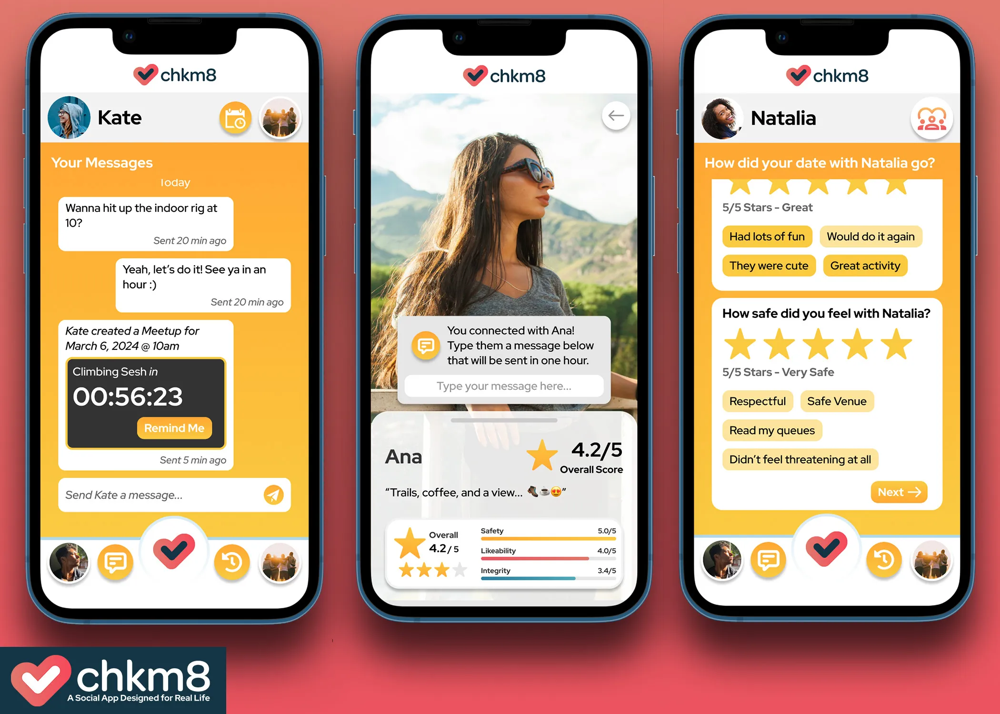
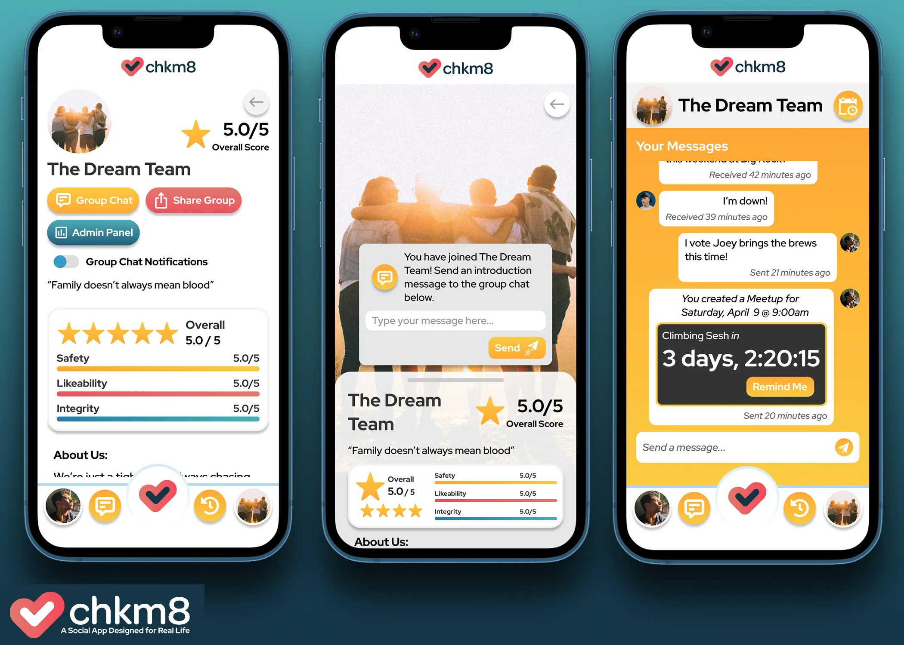
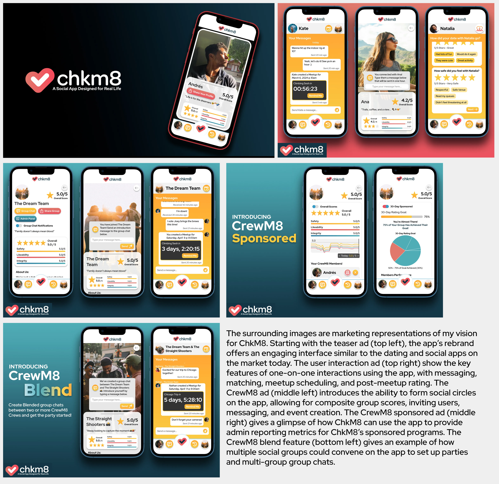

# ChkM8 Mobile App

> Strategic brand redesign for an app curated to empower safer human connections.

| | |
|---|---|
| **Role** | Software Engineer / Brand Strategist |
| **Location** | Remote |
| **Tools** | [Figma](https://www.figma.com) · [Flutter](https://flutter.dev) · [Adobe Photoshop](https://www.adobe.com/products/photoshop.html) · [SVG](https://developer.mozilla.org/en-US/docs/Web/SVG) · [Adobe Fonts](https://fonts.adobe.com) · [Coolors](https://coolors.co) |
| **Links** | [Mobile App Redesign Prototype](https://www.figma.com/proto/7kLGHLJ2fvfE2SD8kljzEQ/ChkM8-Proposal?node-id=0-1&t=9UTvTmOkliIEsjve-1) · [ChkM8 Brand Assessment](./chkm8_brand_assessment.pdf) · [ChkM8 Website](https://www.chkm8.app) |

## Premise

This project is in the context of my work with ChkM8, LLC. ChkM8 is a social app designed to empower users when meeting people offline. As a Software Engineer contracted by ChkM8, I had the opportunity to lead several software projects and consult on technology and branding strategy. This project is a case study of my consulting work on the ChkM8 brand.

## Challenge

Over the course of several contracts, ChkM8 asked me to work as a part of their engineering team and aid in the branding of their app. ChkM8 is a social app designed to empower users when meeting people offline. The goal of the app is to provide a platform where users can give feedback on their interactions with others, creating a safer environment for all. Although my main goal in working with ChkM8 was to provide engineering services, my underlying goal was to help further ChkM8's mission for social justice by providing brand feedback and solutions. One of the ways in which I demonstrated this was by providing a rebrand analysis for the app, offering suggestions for a more cohesive and user-friendly design.

## Solution

The ChkM8 app, as it currently stood, was unengaging and only provided one feature - the ability to schedule meetings with another user and rate the user afterwards. With the concept of rating other humans on a numerical scale being such a sensitive topic, I felt that the app needed a more engaging and user-friendly design. To address this, I created a new brand identity for the app, focusing on a more modern and engaging problem - the Millennial and Gen-Z generation's desire to move offline to meet dating and social needs. In a 39 page brand assessment, I broke down the company's current strategy, target market, and provided new market research, which indicated that over 80% of surveyed Millennials would like to find love offline, but 75% of a demographically similar sample claimed to feel 'digitally trapped'. The 39 page document provided a new brand strategy, logo, color scheme, and font choices for the app, pivoting around the concept of a 'Dating/Social App Designed for Real Life'. This proposal was followed up with a fully designed Figma prototype, which I presented to the ChkM8 team.

## Design and Development Choices

The decision to undertake this project was of my own design. I wanted to show ChkM8 a gesture of my firm belief in their mission to make the world a safer place and offer them a renovated project. The outcome was a product which I am more than proud of. The full span of the marketing content shown in this portfolio entry, the accompanying brand assessment, and the prototype are all of my design. The choices made in the renovated brand reflect my view of Millennial and Gen-Z values based on my experience as a member of the target demographic and statistics to back up the notion. If the company were to take my suggestions into account, I believe that they would be able to better capture their target audience and make a larger impact on the world.

## Result

The resulting app takes ChkM8's current meeting scheduling and scoring features and puts them at the center of an app designed to empower users rather than threaten them with numerical values. The new interface offers a chance for users to express themselves with a profile and bio without making introduction superficial. The new brand identity takes on a similar format as current dating apps, but is designed to take the user offline and into the real world, where they can be assured by digital safety features. The below images show the product's outcome, but only goes halfway to seeing social change. I hope to see the product in action and see the impact it has on the world.

