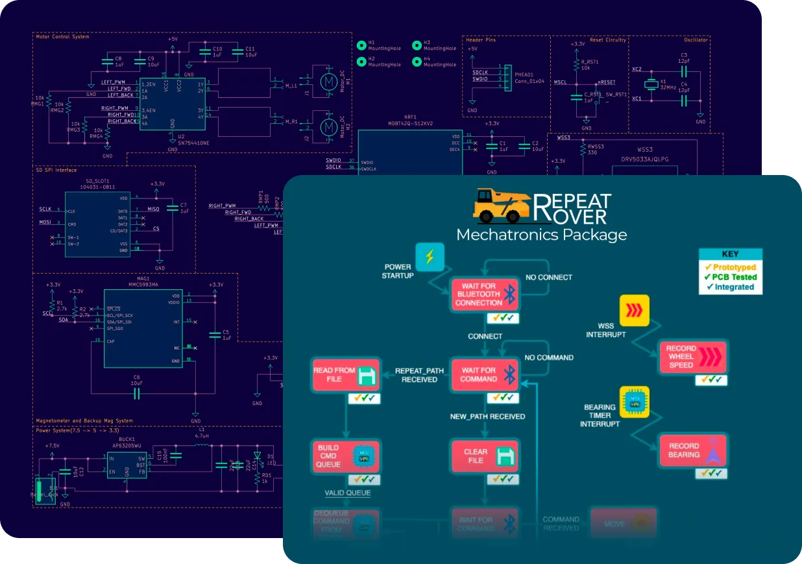
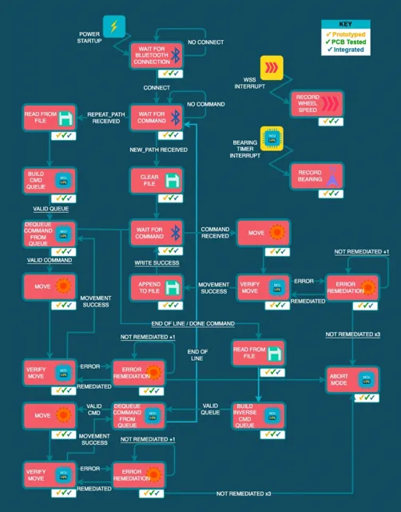
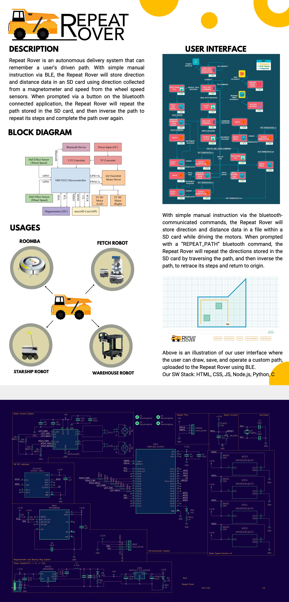

# EV Systems Architecture

> Designing R&D circuits and firmware for the next generation of electric vehicles.

| | |
|---|---|
| **Role** | Embedded Systems Engineer |
| **Location** | Austin, Texas |
| **Tools** | [KiCad](https://www.kicad.org) · [Beagle Board](https://www.beagleboard.org) · [Arduino](https://www.arduino.cc) · [Linux](https://www.linux.org) · [C / C++](https://isocpp.org) · [Python](https://www.python.org) · [Node.js](http://nodejs.org) · [JavaScript](https://www.javascript.com) · [Texas Instruments](https://www.ti.com) · [Nordic](https://www.nordicsemi.com) · [Solidworks](http://solidworks.com) · [Draw.io](http://drawio.com) · [Adafruit](https://www.adafruit.com) · [Git](https://git-scm.com) |

## Challenge

The electric vehicle industry is a fast evolving one. As the industry continues to grow, I have had the pleasure of completing several projects in electric vehicle embedded systems technology, combining both firmware and electrical design. Two of these projects related to distinct yet interconnected domains: the design of an innovative electrical circuit and firmware for a motorcycle with a mechanically modernized transmission system, and the creation of a rover capable of performing repetitive tasks in various repeat process environments. Both projects required cutting-edge solutions that would set new standards in efficiency, performance, and adaptability.

## Solution

Solutions for these projects involved a holistic approach that seamlessly integrated various technologies. For the motorcycle, a state-of-the-art EV Systems Architecture was designed, optimized for telemetry and efficiency, and integrated with the modern transmission system. The rover required a modular and scalable embedded system, equipped with advanced algorithms to enable autonomous learning and task optimization. The image above shows the mechatronics processes for the Repeat Rover project.

## Design and Development Choices

Both projects involved coinciding sets of technology such as the KiCAD electric design suite, Solidworks for modeling custom mechanical components, and C++ as the basic language for providing microcontroller instructions. While the motorcycle project used prototyping controllers such as Arduino and BeagleBone, the rover project was controlled by a Nordic nRF52 chip with custom firmware mounted on a custom PCB. The motorcycle interfaced with custom hardware to interact with the CANBUS, read real-time wheel speed data from the ABS system, and assert motor shifting with asynchronous motors. The rover, on the other hand, used a custom set of reluctors and hall effect sensors, an accelerometer, and bluetooth to receive and compute instructions. Realtime telemetry and testing UI were programmed with Node.js and JavaScript for both projects.

## Result

The combined result of both projects demonstrated an advancement in both the automotive and robotics industries. The data collected from the motorcycle with a modernized transmission system proved significant growth in the future of the EV industry, setting new standards in performance. Simultaneously, the rover's intelligent design enabled it to function in repeat process environments, showcasing the potential for further innovation in automation and robotics.

