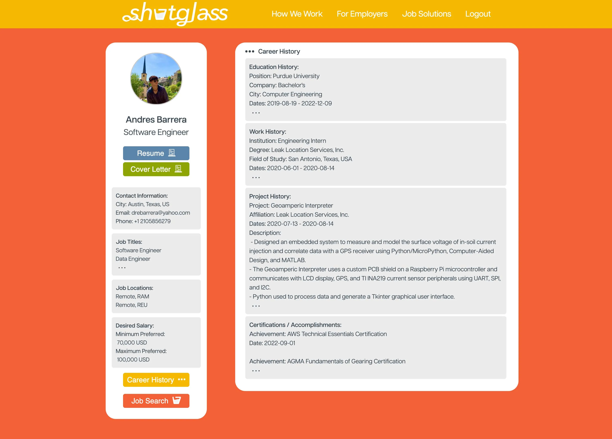
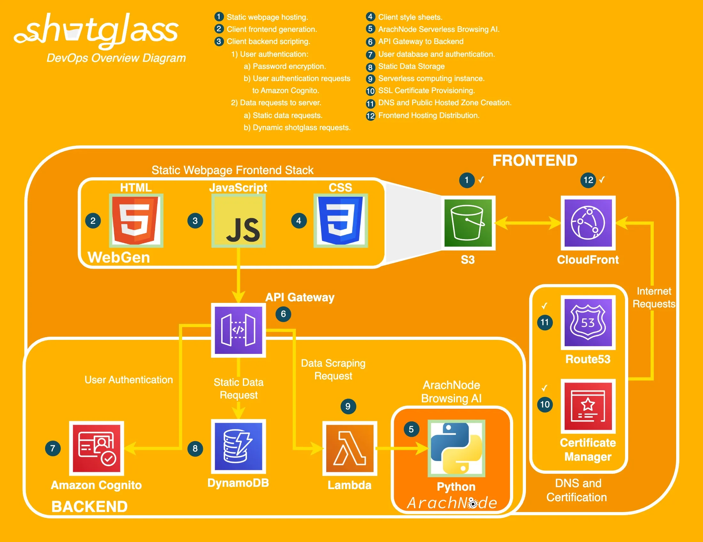

# Shotglass Jobs

> Changing the employment industry with a job board that will apply for you.

| | |
|---|---|
| **Role** | Independent |
| **Location** | Austin, Texas |
| **Tools** | [HTML](https://developer.mozilla.org/en-US/docs/Web/HTML) · [CSS](https://developer.mozilla.org/en-US/docs/Web/CSS) · [JavaScript](https://www.javascript.com) · [jQuery](https://jquery.com) · [Chrome Extensions](https://developer.chrome.com/docs/extensions/) · [Selenium](https://www.selenium.dev) · Photoshop · WebGen · [AWS](http://aws.amazon.com) · [AWS IAM](https://aws.amazon.com/iam/) · [AWS Route53](https://aws.amazon.com/route53/) · [AWS CloudFront](https://aws.amazon.com/cloudfront/) · [AWS S3](https://aws.amazon.com/s3/) · [AWS API Gateway](https://aws.amazon.com/apigateway/) · [AWS Cognito](https://aws.amazon.com/cognito/) · [AWS DynamoDB](https://aws.amazon.com/dynamodb/) · [AWS Lambda](https://aws.amazon.com/lambda/) · [Git](https://git-scm.com) |

## Challenge

The challenge of Shotglass Jobs was to create a web application that could automate the tedious process of job searching by finding, assessing, and submitting applications for job postings tailored to a user's profile. The complexity lay in scraping diverse job platforms, evaluating the relevance of postings, and integrating a seamless user experience that would allow for personalized job application submissions.

## Solution

The solution, Shotglass Jobs, involved designing a web application that utilized data scraping techniques to gather job postings from various platforms. This is to be implemented using the ArachNode AI developed in my simultaneous project. The application assesses the relevance of these postings based on user profiles and preferences and provides an automated submission process using a Selenium Python routine. The entire application is hosted on AWS, leveraging services like S3, Route53, Cloudfront, Cognito User Database, DynamoDB, API Gateway, and AWS Lambda to ensure scalability, security, and performance.

## Design and Development Choices

The frontend of Shotglass Jobs is designed using HTML, CSS, JavaScript, jQuery, and my Python compiler, WebGen. The backend was complex to set up, but saved me on cost and performance - using AWS services to provide hosting, authentication, and data storage for the program. The goal is to be able to provide an interface for creating and editing resume and cover letter templates. User data is already stored and retrieved by the frontend from AWS DynamoDB and AWS Cognito. API Gateway and AWS Lambda manage the serverless functions of the program.

## Result

Although not yet complete, the Shotglass Jobs shows great promise for providing a personalized and automated experience. The project is currently awaiting the production of the ArachNode AI (explained in another one of my projects) to provide the information search algorithm to be used by the web application. So far, the use of AWS services has ensured a scalable, secure, and efficient infrastructure, as shown in the live examples of the site below, where I have collected and displayed data with persistent authentication.

