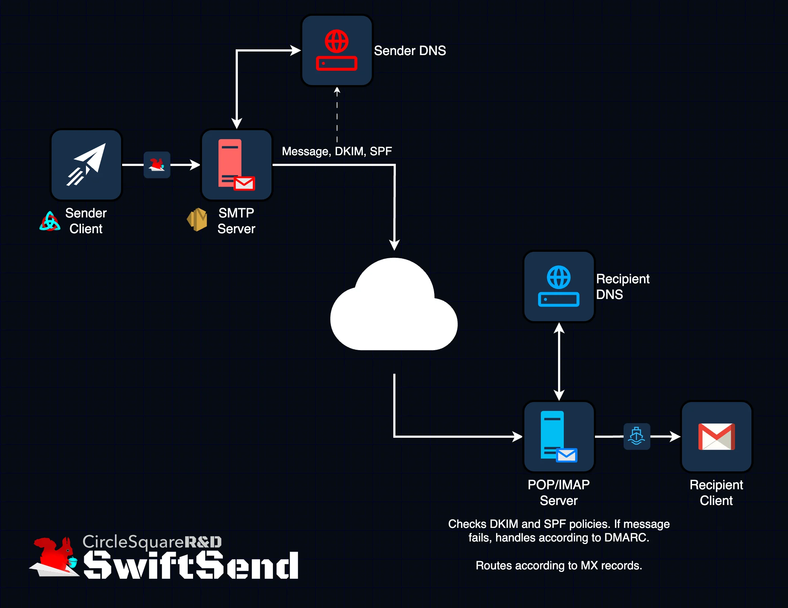
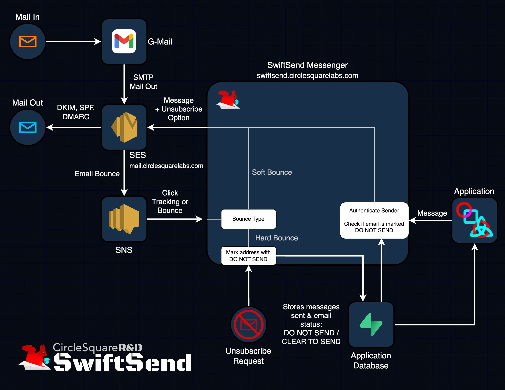
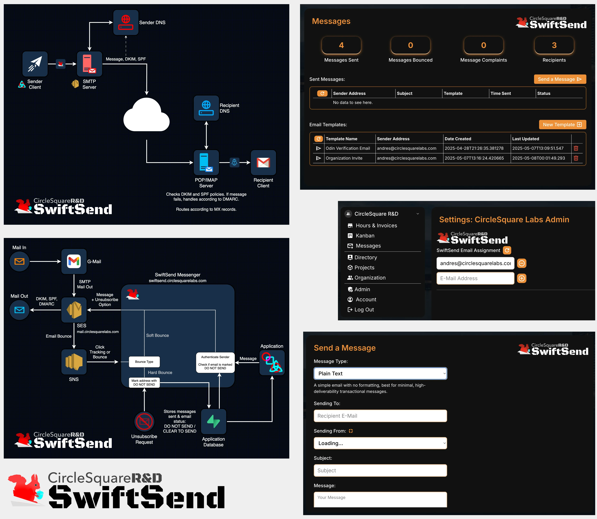

# SwiftSend v1

> Developing and integrating an e-mail backend service into CircleSquare's tech ecosystem.

| | |
|---|---|
| **Organization** | CircleSquare Labs |
| **Location** | Austin, Texas |
| **Tools** | [AWS](http://aws.amazon.com) · [AWS SES](https://aws.amazon.com/ses) · [AWS SNS](https://aws.amazon.com/sns) · [Supabase](https://supabase.com) · [TypeScript](https://www.typescriptlang.org) · [React](https://react.dev) · [Figma](https://www.figma.com) · [TailwindCSS](http://tailwindcss.com) · [Next.js](http://nextjs.org) |
| **Links** | [nominal.drebarrera.com](https://nominal.drebarrera.com) |

## Premise

This project is in the context of my work to build CircleSquare Labs, a full-service technology firm based out of Austin. With a business entity created for client-facing projects and another business entity for research and development, CircleSquare Labs is uniquely positioned to be a leader in pioneer technology in the future.

## Challenge

SwiftSend was conceived out of a growing need within CircleSquare Labs and its affiliated consulting firms to deliver email communications at scale (internally and externally) without relying on costly third-party services. Given the wide range of clients and contractors managed through CircleSquare’s Odin Dashboard, the team required a unified platform for drafting, sending, and tracking both HTML and plain text messages. Whether for project solicitations, onboarding instructions, or internal notices, these communications had to be secure, auditable, and cost-effective. The additional challenge was to create a reusable and extendable backend service that could operate independently, support scalable deployments, and preserve sender reputation, which is critical for avoiding blacklists and ensuring deliverability. All of this had to be built under tight cost constraints and within the bounds of AWS SES's strict policies and sandbox limitations, which posed unique barriers for newer organizations.

## Solution

The core of SwiftSend is a serverless middleware email service that integrates deeply with the Odin Dashboard, using AWS SES as its SMTP backbone. SwiftSend offers full email lifecycle management: users can authenticate via CircleSquare’s Supabase backend, draft HTML or plaintext emails, select sender identities, and monitor bouncebacks and delivery logs, all from within the existing Odin Dashboard interface. Built on an Express.js backend hosted via Vercel's serverless infrastructure, SwiftSend connects to AWS SES for email delivery and uses AWS SNS for server-side feedback (such as bounces, complaints, or delivery status). Each email identity is manually provisioned in AWS and linked to user permissions in SwiftSend’s database to ensure least-privilege access. Gmail’s SMTP aliasing further enhances user flexibility, enabling multi-identity inboxes and outboxes, while maintaining compliance with authentication protocols and domain ownership.

## Design and Development Choices

SwiftSend prioritized speed to market and cost control, choosing AWS SES as the foundational SMTP provider due to its affordability, offering 3,000 free messages monthly and low per-message costs thereafter. However, SES’s low-cost nature comes with notable restrictions: domain ownership verification, strict sandbox limitations, and a manually reviewed production access request process. Messages in sandbox mode can only be sent to verified emails, which hinders onboarding and testing. Moreover, templated messages are limited, and domain reputation must be protected by handling bounces correctly and avoiding misuse. To interface with SES while abstracting away these constraints from users, SwiftSend was designed as a backend middleware API. Although Express.js was used for its familiarity and simplicity, it introduced latency and statefulness. Future iterations will migrate to a lighter, stateless framework like Fastify or Next.js API routes for better cold start performance and serverless compatibility. Recipient state and bounce management were vital features. AWS SNS was configured to update the SwiftSend database in real time, tracking soft bounces, marking hard bounces as invalid, and logging all server responses. Authentication between SES, SNS, and SwiftSend was tightly scoped using IAM policies and row-level Supabase access, enforcing strict data segregation. During development, Gmail’s alias and SMTP connection features proved to be a clever workaround for email reception and sending, leveraging Gmail’s UI for incoming mail while SwiftSend remained responsible for outbound communications and backend orchestration.

## Result

SwiftSend successfully enabled message delivery from Odin Dashboard to verified recipients, offering a functional, low-cost, and secure email management layer for CircleSquare Labs and its partners. However, the system’s deployment was hindered by AWS SES production restrictions. Despite implementing bounce handling, providing clear documentation, and submitting two requests for SES production access, both were denied. The likely causes included SwiftSend’s use of SES in conjunction with Gmail aliasing and the nascent status of CircleSquare Labs’ AWS account. These challenges highlighted SES’s protective posture over its IP space and its preference for larger, well-established senders. Nonetheless, the development process delivered key architectural insights and revealed operational constraints of SES that are now guiding a roadmap for SwiftSend v2, one that may integrate more flexible third-party SMTP providers to avoid SES limitations while retaining the backend abstraction layer.

